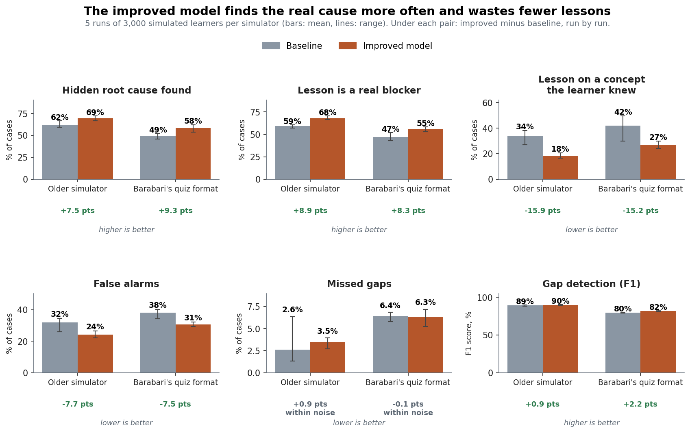
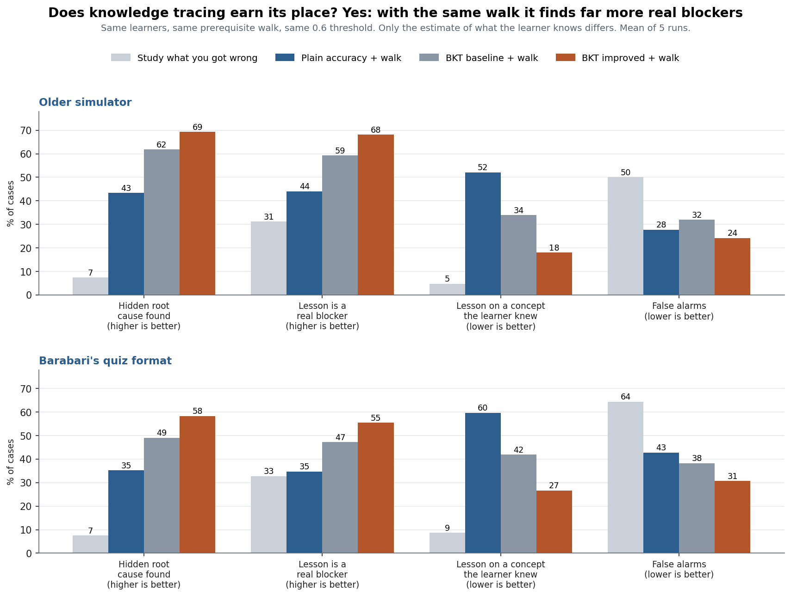
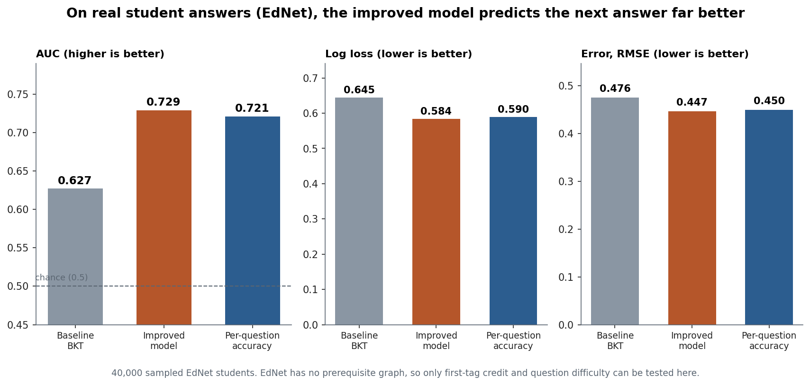
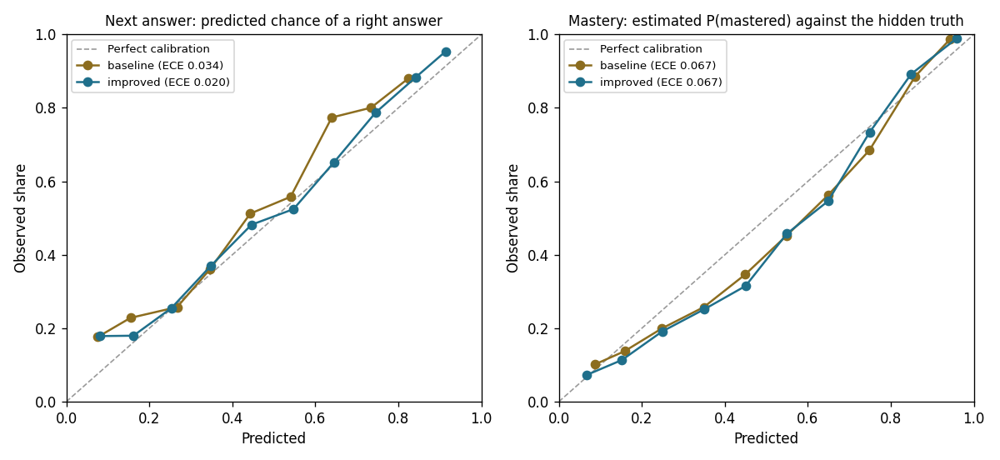

# dsi-monsoon-2026-03b
Identifying what a learner needs next: How might we infer a learner’s current understanding and recommend what they should learn, practise or revisit next?

## Circuit Coach

An adaptive micro-remediation layer for vocational learners. After every quick check it diagnoses the one concept that broke down, prescribes one short fix, and routes unresolved confusion to a trainer.
Anchor NGOs: Barabari Collective, Nirmaan.

This repository holds the **UI prototype** (`frontend/`) and the **knowledge-tracing engine** (`backend/`). By default the prototype runs the engine in the browser; set `VITE_API_URL` to send the model steps to the backend service instead.

| Path | What |
|---|---|
| [`frontend/`](frontend) | Clickable prototype (React + TypeScript + Vite): learner app, trainer console, side-by-side demo, flow map |
| [`backend/`](backend) | Engine service (Python, FastAPI): Bayesian Knowledge Tracing baseline, made-up learner generator, evaluation on made-up and real (EdNet) data |

## Results at a glance



The service answers with the improved model by default. On simulated learners (hidden knowledge known, 5 runs of 3,000 learners per simulator) it finds the real root cause more often (49% to 58% in Barabari's quiz format), sends far fewer learners to a lesson on something they already knew (42% to 27%) and raises fewer false alarms (38% to 31%). Compared run by run, it is clearly better on 12 of 14 measures and not clearly different on the other two (missed gaps).



Is knowledge tracing needed? With the same prerequisite walk, it finds far more real blockers than plain accuracy (hidden cause found 62% against 43%, and 69% for the improved model). "Study what you got wrong" finds it in 7% of cases.



On real student answers (EdNet), the improved model predicts the next answer better than the baseline (AUC 0.729 against 0.627).



The predicted chance of a right answer is well calibrated. The mastery estimate runs about 10 points high between 0.2 and 0.7, so the trainer console shows bands (Needs work, Getting there, Strong) instead of percentages.

More figures, each with a short reading and caveat, are in [`backend/results/overview.md`](backend/results/overview.md): run-by-run differences with 95% intervals, what each model change adds, robustness to wrong tags, the hardest cases, and what the tests protect.

What these results do not show: they come from simulated learners and from EdNet (next-answer prediction only), not from learners at Barabari or Nirmaan, and nothing here shows that learners learn more. Full evidence, limits and the promotion decision: [technical design document](backend/docs/Technical_Design_Doc.md).

## Run locally

```bash
cd frontend
npm install
npm run dev
```

Open http://localhost:5173 and use **Demo scenarios** in the top bar to jump to any point in the story.

To run the knowledge-tracing steps on the engine service instead of in the browser, start it in a second terminal and point the prototype at it:

```bash
cd backend
pip install -e ".[eval,dev]"
python -m uvicorn circuit_coach.api:app --port 8000
```

Then set `VITE_API_URL=http://localhost:8000` in `frontend/.env.local` and restart `npm run dev`; the top bar shows **Engine: API**.

## Run with Docker

```bash
docker compose up --build
```

This builds and starts both parts: the prototype at http://localhost:8080, already connected to the engine service at http://localhost:8000 (API docs at `/docs`). Learner state is kept in SQLite on a Docker volume. Each part also builds on its own: `docker build -t circuit-coach-engine backend` and `docker build -t circuit-coach-app --build-arg VITE_API_URL=http://localhost:8000 frontend`.

## Tests

`cd backend && pytest` for the engine, `cd frontend && npm test && npm run typecheck && npm run build` for the prototype. GitHub Actions runs both, the end-to-end journey against the running service, and a Docker build and smoke test on every push (`.github/workflows/tests.yml`).

## Deploy (Vercel)

Import this repository in Vercel with:

| Setting | Value |
|---|---|
| Root Directory | `frontend` |
| Framework Preset | Vite |
| Build Command | `npm run build` |
| Output Directory | `dist` |

Routing is hash-based, so no rewrite rules are needed.
