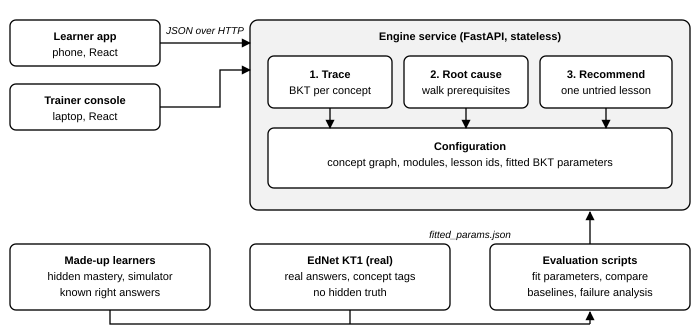

# Circuit Coach: Technical Design (Sprint 4)

**Team:** Impact Theory | **Problem 3B:** Identifying what a learner needs next
**Prototype:** https://dfsi.vercel.app/ | **Code:** `backend/` and `frontend/` in the project repository
**Document:** Technical Design Document revised in Sprint 4 (POC v0.9). Earlier versions: `docs/archive/Sprint2_Technical_Design_Doc.md` (Sprint 2) and `docs/archive/Hack1_Technical_Design_Doc.md` (after Hackathon 1).

Circuit Coach finds what a vocational learner is stuck on after each short quiz, traces it back to the real cause, and recommends one short lesson; a trainer steps in when the learner is still stuck. Since Hackathon 1 the engine reads Barabari's quiz format, an improved model beats the baseline on 13 of 14 measures on made-up learners, and the engine has been tested for edge cases, robustness and calibration.

## 1. Introduction

Our project, **Problem 3B: Identifying what a learner needs next**, works with Barabari Collective and Nirmaan, which run skilling and vocational programmes. Learners study in short sessions, often on their phones, and a misunderstanding can go unnoticed until it blocks later topics. Trainers with large batches cannot see who is struggling or with what. We use a basic electrician course (10 concepts, 6 modules) as the example.

## 2. Changes since Hackathon 1, in response to feedback

| Feedback | From | What we changed | Where |
|---|---|---|---|
| Assess the way the NGO does: subjective assignments and quizzes, not only MCQs | Barabari | The engine reads Barabari's question types: true/false (weaker evidence), instructor-marked short answers (partial credit), points, and retakes (count for less). Trainers mark short answers in a new "To mark" list | `bkt.py`, `barabari.py`, trainer console |
| Get the NGO's quiz format and build to it | Professor | Barabari shared their format; quizzes sit at unit level with a 60% pass mark, which maps onto our module quick checks and our 0.6 gap threshold | `docs/barabari_format.md` |
| Get the NGO's data format to assess the algorithm | Professor | An importer reads Barabari's quiz JSON as is; their data has no concept tags, so questions are tagged by unit with trainer overrides. An adapter endpoint lets their LMS send an attempt directly | `barabari.py`, `POST /v1/barabari/quiz-attempt` |
| Voice-based Q&A between quizzes | Barabari, instructors | Not built yet: the voice service is still to be chosen | PLAN S3-9 |
| Results to improve (our own evaluation) | Sprint 2 analysis | Improved model: first-tag credit, question difficulty, prerequisite-aware learning, more evidence before a lesson | Section 6 |

## 3. Technical specification and architecture

**Inputs:** a learner's answers (concept tags, right or wrong, "I'm not sure", question type, a mark for short answers, attempt number), the concept graph, and the lessons per concept.
**Outputs:** a mastery probability per concept and at most one recommendation: `concept_id`, `observed_concept_id`, `chain`, `strong_concept_id`, `diagnostic_text` (English and Hindi), `recommended_content_id`, `repeat_gap`, `created_at`. Schemas: [api_contract.md](api_contract.md), [openapi.json](openapi.json).

| Component | Role |
|---|---|
| Learner app and trainer console (React, `frontend/`) | Onboarding, quick checks with multiple choice, true/false and short answers; one recommended lesson; "Got it!" and "I'm still stuck"; escalation queue, cohort gaps, short answers to mark |
| Learner store (`mockServer.ts`) | Learner records in the browser's `localStorage`, shared across tabs and the side-by-side demo |
| Engine client (`engineClient.ts`) | Sends the model steps to the service; falls back to the in-browser engine on any failure or after 4 seconds |
| Engine service (FastAPI, `backend/circuit_coach/`) | Trace, root cause, recommend; two models (baseline, improved); optional storage |
| Barabari adapter (`barabari.py`) | Reads Barabari's quiz and attempt JSON, tags questions with concepts, turns attempts into events |
| Storage (`storage.py`, optional) | With `CIRCUIT_COACH_DB` set: each learner's latest state and a log of every model step, on SQLite or PostgreSQL |
| Offline code (`backend/scripts/`) | Simulators, datasets, fitting, model comparison, robustness, calibration, failure analysis |

| Endpoint | Purpose |
|---|---|
| `POST /v1/onboarding` | Seed a new learner from experience and the placement quiz |
| `POST /v1/quiz-result` | Update the model from a quick check; return at most one recommendation |
| `POST /v1/got-it` | Learning step after "Got it!" |
| `POST /v1/marked-answer` | A trainer's mark for a short answer, as partial credit |
| `POST /v1/barabari/quiz-attempt` | One attempt in Barabari's own format: recommendation and quiz score |
| `GET /v1/learners/{id}/state` | A saved learner state (storage on) |
| `GET /v1/concepts`, `GET /health` | Concept graph and lessons; service status, default and available models |

Every POST accepts `?model=baseline|improved`. With storage on, it also accepts `learner_id` (continue from the saved state) and `request_id` (a resent request is applied once).

## 4. The engine

1. **Trace.** One Bayesian Knowledge Tracing model per concept (mastered or not), with starting mastery, learning, slip and guess fitted by EM. After each answer the estimate is updated by Bayes' rule, then learning is applied. "I'm not sure" is a wrong answer with almost no chance of a lucky guess. True/false answers allow a 50% guess, short answers 5%. A marked short answer (0 to 1) mixes the right-answer and wrong-answer updates. Attempt k of a retaken quiz counts with weight 0.5 to the power k minus 1, because Barabari reveals answers after 3 attempts.
2. **Find the gap.** Among the concepts the quick check assessed, a concept with at least one answer and mastery below 0.6 is a gap; the most advanced one is the observed gap.
3. **Find the root cause.** Walk back to the weakest prerequisite that has been answered and is also below 0.6, and repeat.
4. **Recommend.** The first lesson for the root cause that the learner has not tried. A failed follow-up check after "Got it!" gives a repeat-gap recommendation with a different lesson and flags the trainer.

**The improved model** adds four options, tuned on a separate seed:

| Option | What it does |
|---|---|
| First-tag credit | A question tagged with several concepts updates only its first, main concept |
| Question difficulty | Slip and guess shift per question by its difficulty, estimated from training answers |
| Prerequisite-aware learning | Learning runs slower (down to half) while observed prerequisites look weak |
| More evidence before a lesson | A lesson needs 2 answers on the concept, unless its mastery is below 0.4 after one |

The baseline stays the service default (section 7); either model is selectable per request, for the whole service (`CIRCUIT_COACH_MODEL`) or for the prototype (`VITE_ENGINE_MODEL`).

## 5. Data and evaluation design

| Dataset | What it is | What it can test |
|---|---|---|
| Made-up learners, Sprint 2 simulator | 3,000 learners per run, hidden mastery known, multiple choice only | Next-answer prediction and diagnosis against the truth |
| Made-up learners, Barabari simulator | As above, plus true/false, short answers, points, question difficulty, retakes of failed checks and answers remembered after the reveal | The same, under Barabari's format |
| EdNet KT1 | 14,460 real students, 189 concept tags, 357,756 test answers (1,765,406 in the full sample) | Next-answer prediction only |
| Barabari sample | One unit quiz in Barabari's JSON with made-up attempts | The importer and the adapter endpoint |

Splits are by learner (70:30 for made-up learners, 80:20 for EdNet). Measures: AUC, accuracy, log loss and RMSE for the next answer; for diagnosis, gap F1, whether the recommendation is a true blocker, hidden-prerequisite blockers found, lessons on a concept the learner knew, missed gaps and false alarms. Settings are chosen on tuning seed 100; results are on evaluation seeds 0 to 4. No real NGO learner data exists yet.

## 6. Results

### 6.1 Improved model against the baseline (5 runs of 3,000 made-up learners)

| Measure | Sprint 2 sim: baseline | improved | Barabari sim: baseline | improved |
|---|---|---|---|---|
| Next-answer AUC | 0.688 | 0.694 | 0.672 | 0.701 |
| Mean fitted slip (true about 0.09) | 0.264 | 0.155 | 0.277 | 0.193 |
| Recommendation is a true blocker | 59.2% | 68.1% | 47.2% | 55.5% |
| Hidden-prerequisite blocker found | 61.9% | 69.3% | 49.0% | 58.3% |
| Lesson on a concept the learner knew | 33.9% | 18.0% | 41.9% | 26.6% |
| Missed gaps | 2.6% | 3.5% | 6.4% | 6.3% |
| False alarms | 31.9% | 24.2% | 38.2% | 30.7% |

First-tag credit gives the largest gain; question difficulty lifts prediction where questions differ; prerequisite-aware learning wins back missed gaps; the evidence rule cuts false alarms. Full ablation: `results/model_comparison.md`.

### 6.2 Real data: EdNet (Sprint 2 result)

Per-question accuracy (AUC 0.721) beats fitted BKT (0.627; 0.641 with the first tag only), because BKT ignores question difficulty. The improved model adds question difficulty, but the EdNet comparison has not been rerun: the raw files are not in the repository.

### 6.3 Robustness

| Condition (Barabari sim, improved model) | True blocker | Hidden blocker found | False alarms |
|---|---|---|---|
| Correct tags and graph | 54.1% | 56.8% | 29.7% |
| 10% of questions mis-tagged | 48.9% | 53.4% | 31.8% |
| 25% of questions mis-tagged | 42.1% | 44.5% | 36.0% |
| 3 prerequisite links missing | 47.7% | 43.2% | 29.3% |
| 3 wrong prerequisite links added | 52.0% | 55.0% | 29.8% |

The improved model stays ahead of the baseline in every condition. Missing links hurt most; wrong extra links barely matter. With first-tag credit, only 4% to 6% of fitted parameters sit on a bound (16% to 21% before). Details: `results/robustness.md`.

### 6.4 Calibration

Next-answer probabilities are well calibrated (expected calibration error 0.022 improved, 0.034 baseline). Mastery estimates run about 10 points high between 0.2 and 0.7 (error 0.07): at an estimate near 0.6 about half the learners truly know the concept. The ranking of learners is good (mastery AUC 0.79 to 0.85), so recommendations hold, but the numbers shown to trainers should be recalibrated. Details: `results/calibration.md`.

### 6.5 Failure analysis (hidden-prerequisite cases)

| What happened | Sprint 2 sim: baseline | improved | Barabari sim: baseline | improved |
|---|---|---|---|---|
| Found the true blocker | 66.6% | 72.2% | 45.7% | 59.8% |
| Recommended a concept the learner knew | 20.2% | 13.0% | 41.8% | 18.4% |
| Blocker asked about but looked fine | 8.5% | 9.8% | 4.2% | 14.9% |
| Real gap, but the blocker was further upstream | 2.9% | 4.0% | 3.3% | 4.4% |
| No gap seen | 1.9% | 0.9% | 4.9% | 2.5% |

First-tag credit stops a wrong answer on a two-concept question from blaming both concepts. The cost is that a prerequisite is judged on fewer answers, so more blockers look fine.

## 7. What worked, what did not, and the promotion decision

**Worked**

- Reading Barabari's format changed the evidence the model uses without changing the product's flow.
- The improved model beats the baseline on 13 of 14 measures, on both simulators.
- The engine handles edge cases with a defined behaviour (empty quiz, all "I'm not sure", impossible values, duplicate requests), and the browser engine follows the same rules.

**Did not work, or not yet**

1. Missed gaps on the Sprint 2 simulator rose from 2.6% to 3.5% with the improved model, against the target of no more than 2.6%.
2. The EdNet comparison for the improved model has not been run.
3. Mastery estimates are over-confident in the middle range.
4. Concept tags in Barabari's data do not exist yet; unit-level tags put several concepts on every question, the case first-tag credit handles worst.

**Promotion decision.** The improved model is not the default yet because of points 1 and 2. It is fully available and tested; the decision is recorded in `docs/evaluation.md`. The model is frozen at tag `v0.9`; the EdNet comparison is future work.

## 8. POC v0.9 status

| Part | State |
|---|---|
| Learner app and trainer console (English and Hindi) with true/false, short answers and marking | Working |
| Engine service with two models, Barabari adapter, marked answers, optional storage | Working; 191 backend tests |
| Prototype with fallback to the browser engine | Working; 33 frontend tests, 8 more with the service running |
| Made-up learners in two formats, Barabari sample, EdNet loader | Working |
| Evaluation: model comparison, robustness, calibration, failure analysis | Reproducible, reports in `backend/results/` |
| Demo plan | `docs/demo_plan.md` |
| Voice support, demo video | Open |
| EdNet comparison of the improved model | Future work (after the `v0.9` freeze) |

## 9. Limitations

- No real learner data from the NGOs: results reflect the simulators' assumptions and EdNet's different subject and population.
- Nothing yet shows that learners learn more.
- Barabari's attempt records are read in an assumed shape until they share theirs (`docs/barabari_format.md`).
- The improved model's settings were tuned on made-up learners.
- Two copies of the engine (Python and the browser) are kept in step by tests; the browser copy has only the baseline model.
