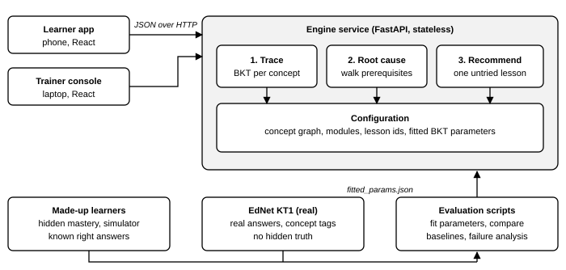
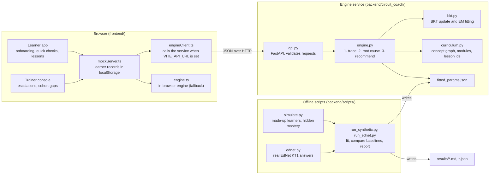
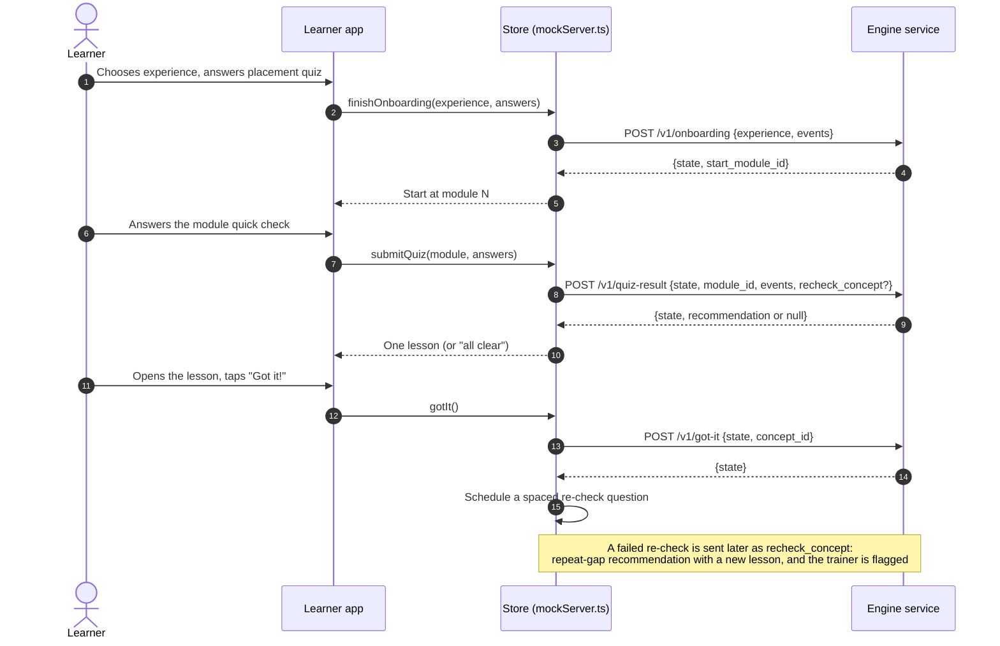

# System architecture

Circuit Coach has three parts: a React app (learner app and trainer console), a stateless engine service (FastAPI), and offline evaluation scripts. This page describes each part, how data moves between them, and where each piece of the code lives. The request and response schemas are in [api_contract.md](api_contract.md).

## 1. Components

| Component | Code | Responsibility |
|---|---|---|
| Learner app | `frontend/src/learner/` | Onboarding, module quick checks, the one recommended lesson, "Got it!" and "I'm still stuck" |
| Trainer console | `frontend/src/educator/` | Escalation queue, repeat gaps, cohort gaps, replies to learners |
| Learner store | `frontend/src/api/mockServer.ts` | Holds every learner record (answers, mastery, tried lessons, re-checks, escalations) in `localStorage` |
| Engine client | `frontend/src/api/engineClient.ts` | Sends the three model steps to the service, reports the engine mode, falls back on any failure |
| In-browser engine | `frontend/src/engine/engine.ts` | Same logic as the service, used when there is no service or it is unreachable |
| HTTP layer | `backend/circuit_coach/api.py` | Request validation, the five endpoints, CORS |
| Engine | `backend/circuit_coach/engine.py` | Tracing, root-cause walk, one recommendation, onboarding |
| BKT | `backend/circuit_coach/bkt.py` | Per-concept Bayesian Knowledge Tracing and EM fitting |
| Curriculum | `backend/circuit_coach/curriculum.py` | Concept graph, modules and lesson ids; must match `frontend/src/data/` (checked by `tests/test_parity.py`) |
| Parameters | `backend/circuit_coach/fitted_params.json` | Fitted BKT parameters loaded at start-up (hand-set values if the file is missing) |
| Simulator | `backend/circuit_coach/simulate.py` | Made-up learners with known hidden mastery |
| Evaluation | `backend/scripts/`, `backend/circuit_coach/prediction.py`, `diagnosis_eval.py` | Baselines, metrics, reports in `backend/results/` |

## 2. Where state lives

The service is **stateless**. Each request carries the learner's model state and each response returns the updated state:

| Field | Type | Meaning |
|---|---|---|
| `mastery` | concept id to number in [0.01, 0.99] | P(concept mastered) |
| `observations` | concept id to integer | Answers seen per concept |
| `tried` | concept id to list of lesson ids | Lessons the learner has already opened |

Everything else (answers, re-check schedule, escalations, messages) is kept by the frontend store. Persistence on the server (SQLite first, PostgreSQL by changing the connection URL) is planned but not built, so nothing is stored server side today.

## 3. Data flow for one learner

If any call fails (network error, non-2xx status, or no answer in 4 seconds) `engineClient.ts` returns `null`, the store runs the same step with the in-browser engine, and the top bar switches to "Engine: API unreachable, using browser". The learner flow never stops.

## 4. Engine steps

1. **Trace.** For every answer, update P(mastered) for each concept the question is tagged with (standard BKT, one model per concept). "I'm not sure" is treated as a wrong answer with almost no chance of a lucky guess (`UNSURE_GUESS = 0.02`).
2. **Root cause.** Among the concepts the quick check assessed, take the most advanced one below the gap threshold (0.6). Walk back through its prerequisites to the weakest one that has been observed and is also below 0.6, and repeat until no weak prerequisite remains.
3. **Recommend.** Return the first lesson for the root-cause concept that the learner has not tried. A failed re-check gives a repeat-gap recommendation that uses a different lesson.

Details and tests: [bkt.md](bkt.md) and [diagnosis.md](diagnosis.md).

## 5. Deployment

| Piece | How it runs |
|---|---|
| Frontend | Static build (`npm run build`), deployed on Vercel with root directory `frontend` |
| Service | `uvicorn circuit_coach.api:app --port 8000`; `ALLOWED_ORIGINS` sets CORS (comma separated, default `*`) |
| Connection | `VITE_API_URL` in `frontend/.env.local`; unset means the in-browser engine only |
