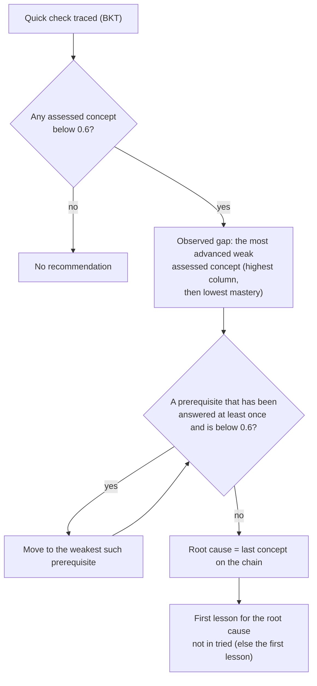

# Prerequisite diagnosis and recommendations

Code: `Engine.recommend`, `observed_gap`, `root_cause`, `pick_content` and `recommend_repeat` in `circuit_coach/engine.py`. Tests: `tests/test_diagnosis.py` and `tests/test_engine.py`. The browser copy of the same rules is `frontend/src/engine/engine.ts`.

After a quick check, the engine turns the updated mastery values into **at most one** lesson.

## Steps

1. **Detect gaps.** A concept is a gap when its mastery is below `WEAK = 0.6`; exactly 0.6 is not a gap. Only the concepts the module's quick check assesses are considered.
2. **Pick the observed gap.** If several assessed concepts are weak, the most advanced one in the concept graph is chosen (it is the one the learner is actually stuck on), and ties go to the weaker one.
3. **Walk the assessed prerequisites.** From the observed gap, move to the weakest prerequisite that is below 0.6 **and** has at least one observation. Repeat from there. A prerequisite never answered is not blamed, because there is no evidence about it. The walk records the path as `chain`, for example `["fault", "diagrams", "symbols", "quantities"]`.
4. **Select the first untried lesson** for the root cause from `CONTENT` in `curriculum.py`, skipping ids in `tried[concept]`. If all have been tried, the first is offered again; by then the trainer has been involved through escalation.
5. **Explain it.** `diagnostic_text` (English and Hindi) names the observed concept and the root cause when they differ, or praises a strong assessed concept when there is one.

## Repeat-gap checks

When the learner taps "Got it!", the frontend schedules a spaced re-check question on that concept. If the re-check is answered wrongly, the frontend sends `recheck_concept` with the next quiz result and the engine calls `recommend_repeat`:

- the recommendation is flagged `repeat_gap: true` and uses a lesson not tried yet, so the same fix is not repeated;
- it is returned even if the model now rates the concept at 0.6 or more (the failed check outweighs the "Got it!" learning step);
- the prerequisite walk still runs, so a repeat gap can point further back;
- the frontend opens an escalation for the trainer with `repeat_gap` set, which puts it at the top of the trainer's queue.

## What the tests check

| Requirement | Tests in `tests/test_diagnosis.py` |
|---|---|
| Gap threshold 0.6 | `test_gap_threshold_is_point_six`, `test_only_assessed_concepts_can_be_the_observed_gap`, `test_the_most_advanced_weak_concept_is_the_observed_gap`, `test_between_equally_advanced_gaps_the_weaker_one_is_chosen` |
| Direct gaps | `test_direct_gap_when_prerequisites_are_strong` (also `tests/test_engine.py::test_direct_gap_names_the_assessed_concept`) |
| Prerequisite gaps | `test_weak_prerequisite_is_the_root_cause`, `test_the_weakest_of_several_weak_prerequisites_is_followed`, `test_the_walk_continues_through_several_levels`, `test_prerequisites_at_or_above_the_threshold_are_not_blamed`, `test_only_assessed_prerequisites_are_walked`, `test_without_the_walk_the_observed_concept_is_recommended`, `test_the_diagnostic_text_names_both_concepts_for_a_prerequisite_gap` |
| Tried lessons | `test_the_first_untried_lesson_is_chosen` (3 cases), `test_lessons_tried_for_another_concept_do_not_count`, `test_tried_lessons_apply_to_the_root_cause`, `test_when_every_lesson_was_tried_the_first_is_offered_again` |
| Repeat gaps | `test_repeat_gap_is_flagged_and_uses_a_new_lesson`, `test_repeat_gap_is_returned_even_if_the_model_thinks_the_concept_is_fine`, `test_repeat_gap_can_still_point_to_a_weak_prerequisite` |
| Same behaviour over HTTP | `test_api_follows_the_same_rules` |

## How well it works

From `results/synthetic_results.md` (made-up learners with known hidden mastery, 5 runs of 3,000, fitted parameters):

| Method | Recommendation is a true blocker | Hidden-prerequisite cases: blocker found | False alarms |
|---|---|---|---|
| Study what you got wrong (status quo) | 31.2% | 7.4% | 50.0% |
| BKT, recommend the assessed concept | 28.5% | 5.0% | 31.9% |
| BKT + prerequisite walk | 59.2% | 61.9% | 31.9% |

The walk is what finds hidden prerequisite gaps. About 32% of checks with no real gap still trigger a lesson, and in hidden-prerequisite cases about 32% of misses recommend a concept the learner already knew (`results/failure_analysis.md`). The walk is a rule applied after the model, not part of it; a prerequisite-aware model is the planned next step.
