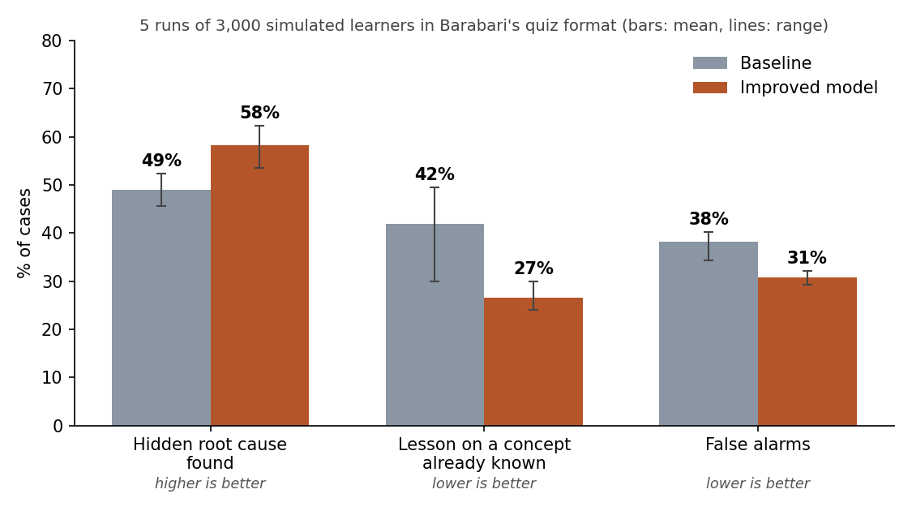
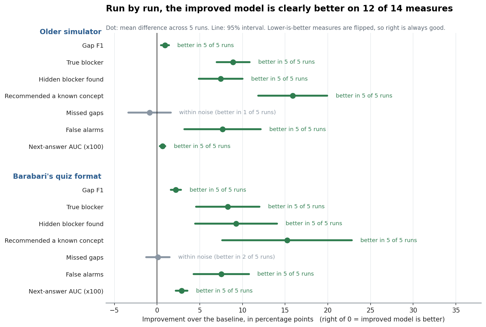
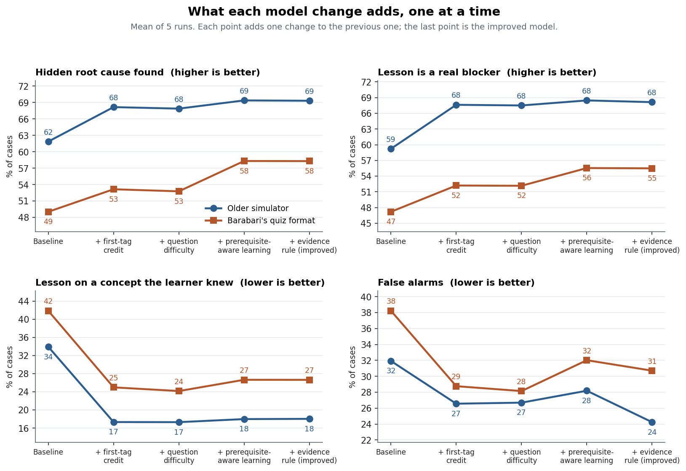
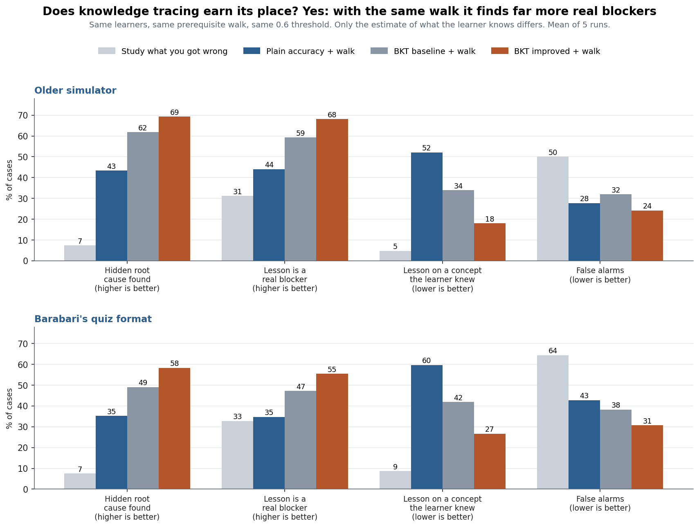
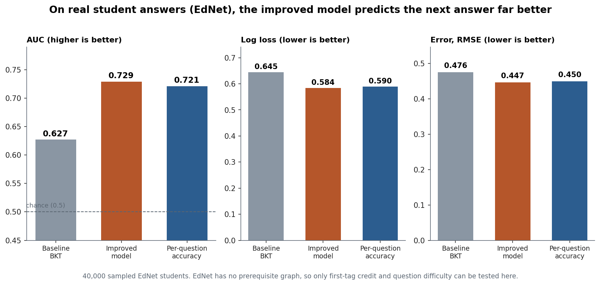
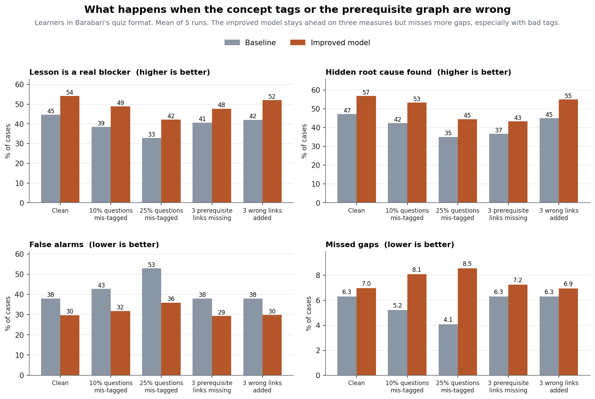
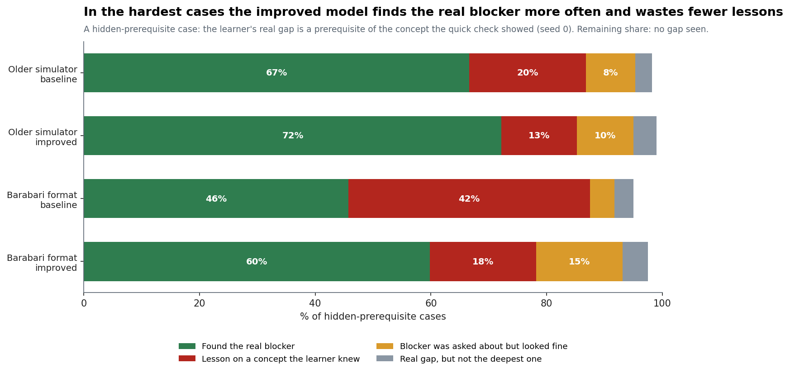
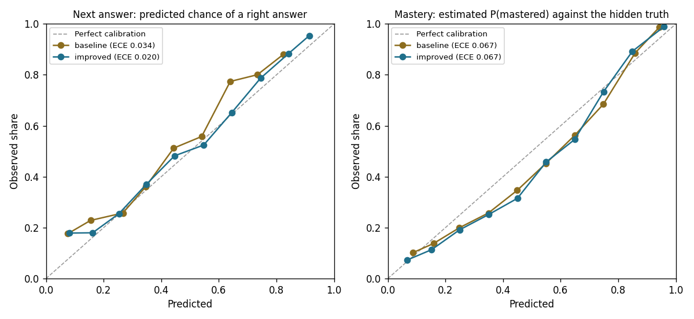
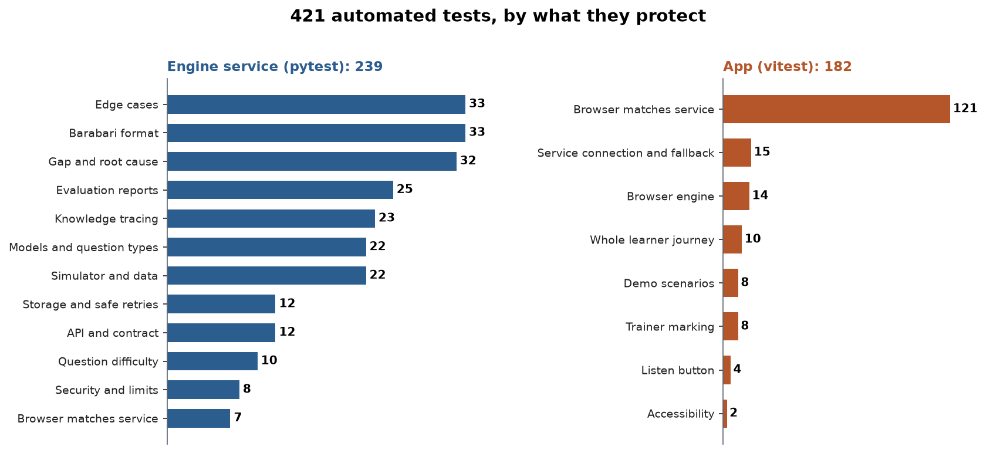

# Evaluation at a glance

Every figure here is drawn from the saved results in this folder by `scripts/plot_results.py` (nothing is refitted), so each one can be regenerated:

```bash
python scripts/plot_results.py
```

Simulated learners come in two kinds. The **older simulator** gives multiple-choice questions only. The **Barabari format** adds true/false, written answers, points, retakes and question difficulty. In both, the learner's true knowledge is known, so we can check whether the engine finds the real gap. Each result is the mean of 5 runs of 3,000 learners.

## 1. Baseline against the improved model



**Reading it.** Each panel is one measure. Grey is the baseline, copper the improved model. The coloured number under each pair is the difference, improved minus baseline, taken run by run.

**Takeaway.** The improved model finds the hidden root cause more often (62% to 69%, and 49% to 58% in Barabari's format), recommends a real blocker more often, sends far fewer learners to a lesson on something they already knew (42% to 27% in Barabari's format) and raises fewer false alarms (38% to 31%).

**Caveat.** Missed gaps do not improve: 2.6% against 3.5% on the older simulator, and 6.4% against 6.3% in Barabari's format. The difference is within the noise of 5 runs. This is the cost we accepted when making the improved model the default.

## 2. Is the difference real? (run by run)



**Reading it.** Both models see exactly the same learners in each run, so the difference can be taken inside a run. A dot is the mean difference, a line the 95% interval over the 5 runs. Right of the zero line is better for the improved model; lower-is-better measures are flipped.

**Takeaway.** On 12 of 14 measures the whole interval is to the right of zero and the improved model wins in all 5 runs. The other 2 are missed gaps.

**Caveat.** With only 5 runs the intervals are wide. On the older simulator the improved model misses more gaps in 4 of the 5 runs, which a mean alone would hide.

## 3. What each change adds



**Reading it.** Each point adds one change to the one before. The last point is the improved model.

**Takeaway.** Crediting only a question's first tag brings the biggest gain, because a wrong answer on a two-concept question no longer blames both concepts. Prerequisite-aware learning adds most in Barabari's format (hidden cause found 53% to 58%). The "two answers before a lesson" rule trims false alarms on the older simulator (28% to 24%).

**Caveat.** These changes interact. Question difficulty barely changes the diagnosis; its value shows up in predicting answers (figure 5).

## 4. Does knowledge tracing earn its place?



**Reading it.** "Study what you got wrong" is the usual practice. The other three methods all use the same prerequisite walk and the same 0.6 threshold, and differ only in how they estimate what the learner knows: plain accuracy so far, our baseline tracing, or the improved tracing.

**Takeaway.** The status quo finds the hidden cause in only 7% of cases. Giving the walk to plain accuracy lifts that to 43% (older) and 35% (Barabari). Knowledge tracing goes further, to 62% and 49%, and the improved model to 69% and 58%. Accuracy also recommends a lesson on a concept the learner already knew 52% to 60% of the time, because it never forgets an early wrong answer.

**Caveat.** The status quo shows few lessons on known concepts (5% to 9%) only because it almost never looks beyond the question that was answered wrong.

## 5. Real student answers (EdNet)



**Reading it.** 40,000 sampled students; each model predicts whether the next answer is right. AUC is the chance that a right answer is ranked above a wrong one (0.5 is chance).

**Takeaway.** The improved model reaches AUC 0.729 against 0.627 for the baseline, and slightly above per-question accuracy (0.721), because question difficulty now matters. Log loss and error fall too.

**Caveat.** EdNet is a Korean English-test tutor and has no prerequisite graph, so only first-tag credit and question difficulty can be tested there. It says nothing direct about electrician learners.

## 6. Wrong tags or a wrong prerequisite graph



**Takeaway.** The improved model stays ahead of the baseline on real blockers, hidden causes and false alarms in every condition. Missing prerequisite links hurt the hidden-cause measure most (about 13 points); extra wrong links barely matter. Bad tags hurt too: with 25% of questions mis-tagged, the improved model finds a real blocker 42% of the time, just below the baseline with clean tags (45%).

**Caveat.** Missed gaps grow with bad tags (8.5% against 4.1% at 25% mis-tagging). This is why a trainer checks the concept tags.

## 7. The hardest cases



**Reading it.** These are the cases where the learner's real gap is a prerequisite of the concept the quick check showed (seed 0).

**Takeaway.** The improved model finds the real blocker more often (67% to 72%, and 46% to 60%) and sends fewer learners to something they already knew (20% to 13%, and 42% to 18%).

**Caveat.** The orange share, a blocker that was asked about but looked fine, grows (4% to 15% in Barabari's format). Judging a prerequisite on fewer answers is the price of crediting only the first tag.

## 8. Calibration



**Takeaway.** The predicted chance of a right answer is well calibrated. The mastery estimate runs about 10 points high between 0.2 and 0.7, so the trainer console shows bands (Needs work, Getting there, Strong) rather than percentages. See `calibration.md`.

## 9. What the tests protect



**Takeaway.** 239 engine tests and 182 app tests (8 of the app tests also need the service running). The most heavily tested areas are the ones that went wrong in the project review: edge cases, Barabari's format, and the gap and root-cause logic.

## What these results do not show

They come from simulated learners and from EdNet, not from learners at Barabari or Nirmaan. Nothing here shows that learners learn more.
